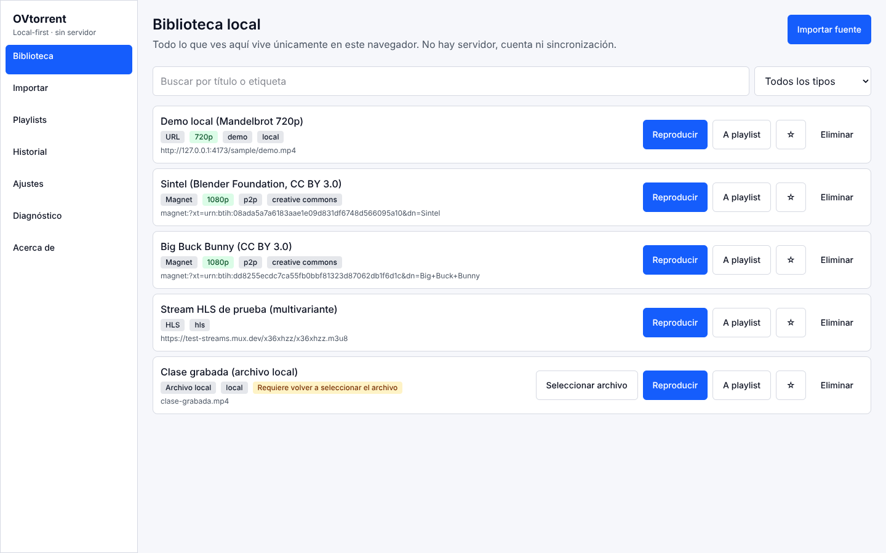
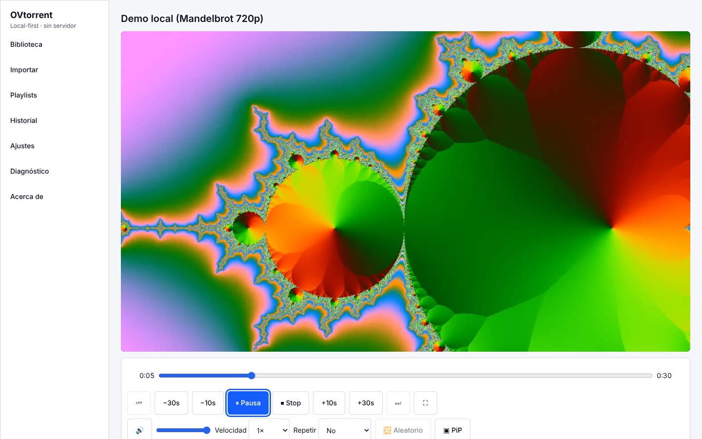
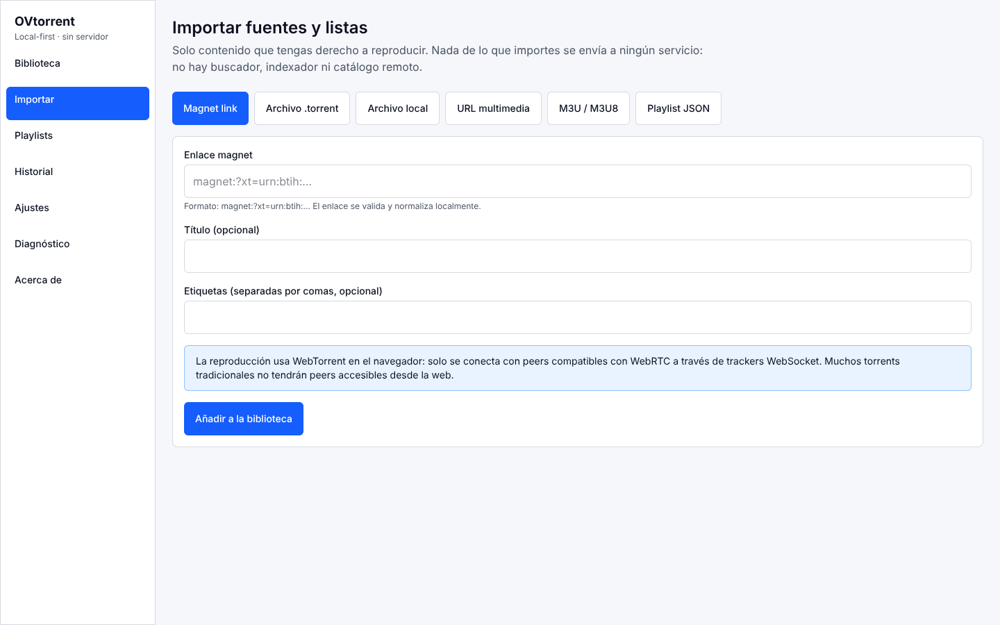
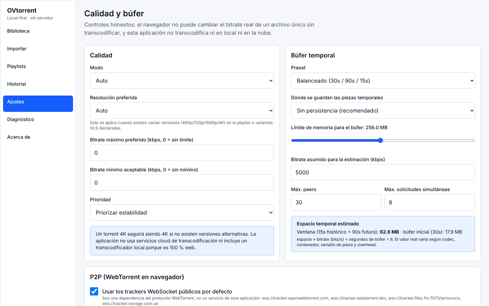
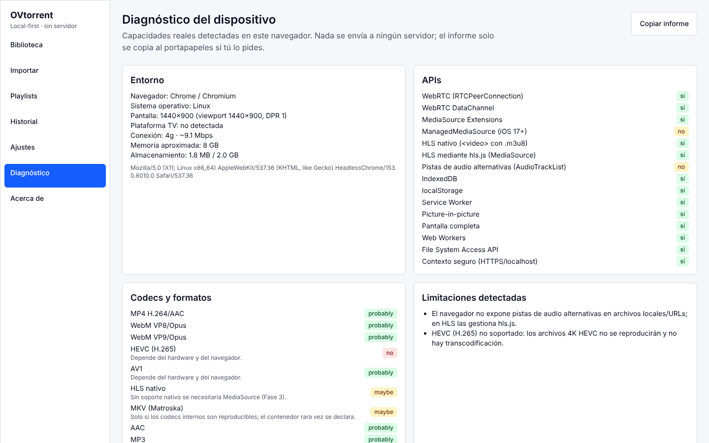
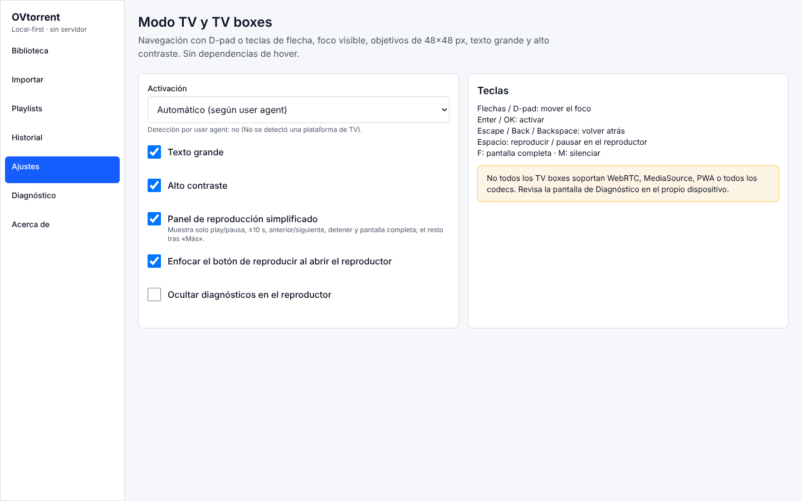
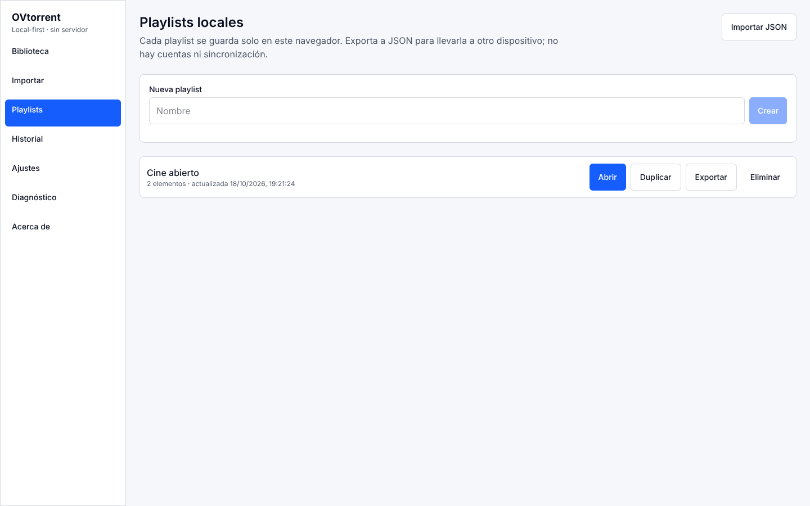

# OVtorrent

<p align="center"><b>English</b> · <a href="README.es.md">Español</a></p>

**Peer-to-peer web video player with a limited temporary buffer and automatic cleanup of session data.**

A 100% static PWA: it runs entirely in the browser, with no backend, no database, no accounts, no API keys and no paid services. It deploys as static files on any HTTP server (Vercel, GitHub Pages, Cloudflare Pages, Netlify, Nginx or a local server).

🔗 **Live demo:** [o-vtorrent.vercel.app](https://o-vtorrent.vercel.app)



The interface is in Spanish.

## Screenshots

| | |
|---|---|
|  **Player** with keyboard controls, playback speed, repeat and picture-in-picture |  **Import** a magnet link, .torrent, local file, URL, M3U/M3U8 or JSON playlist |
|  **Quality and buffer**: time window, memory limit and storage estimate |  **Diagnostics**: the browser's real APIs, codecs and limitations |
|  **TV mode** with D-pad navigation, large text and high contrast |  **Local playlists**, exportable as JSON |

## What it does (and what it doesn't)

- Plays **authorized** media from: magnet links and `.torrent` files (WebTorrent in the browser, WebRTC-compatible peers only), local media files, manually entered media URLs, M3U/M3U8 lists, HLS sources (native or via hls.js) and JSON playlists.
- Keeps **everything** in the browser: preferences, theme, player settings, quality and buffer, playlists, history, favorites, your own metadata, TV mode and non-sensitive diagnostics.
- Prioritizes **temporary playback**: it doesn't intentionally download the whole file. It requests the pieces near the current position, keeps a configurable look-ahead and look-behind window, and clears the rest when you stop, switch sources or close the tab.
- Does **not** include search, indexing, scraping, a remote catalog, accounts, telemetry, analytics or a proxy.

We don't describe it as "downloads nothing": every playback needs to transfer data to the browser, and the browser or the P2P library may apply internal caches the app can't always control.

## Highlights

- **WebTorrent engine in the browser** (WebRTC + WebSocket trackers): file selection inside a torrent, peer and speed metrics, sequential priority with a time window, and an ephemeral buffer in RAM or IndexedDB that restarts automatically when it exceeds the memory limit.
- **HLS and M3U/M3U8**: multivariant HLS (native or hls.js over MediaSource), quality selection among declared variants, SRT subtitles converted locally to WebVTT, and alternative audio tracks when the source and browser expose them.
- **Performance**: a Web Worker for parsing and metrics (with fallback), automatic smaller windows on low-RAM devices, virtualized lists, and paused polling in hidden tabs.
- **Offline-ready PWA**: the interface and settings work without a network thanks to a Service Worker app shell.
- **TV mode**: D-pad navigation, visible focus, 48×48 px targets and a simplified playback panel for TV boxes.
- **Quality**: automated security audit and accessibility audit with axe, documented in `docs/`.

## Design constraints

| Requirement | How it's met |
| --- | --- |
| No database | Only `localStorage`, `sessionStorage`, **local** IndexedDB (optional ephemeral buffer) and memory. |
| No backend | No Node.js process in production. Node is only used to build and to serve during development. |
| No paid services or accounts | No API keys, subscriptions, Firebase, Supabase, OAuth, private trackers or custom signaling. Public WebSocket trackers are part of the WebTorrent protocol and can be changed or turned off. |
| Open source | MIT license; MIT/Apache-2.0 dependencies ([docs/LICENSES.md](docs/LICENSES.md)). |
| Offline | The interface and settings work without a network. P2P streaming and remote URLs need Internet. |

## Paste a magnet and play: the bridge

A browser can only reach WebRTC peers, so most "regular" magnets (TCP/UDP swarms) have no peers reachable from the web. So that pasting a magnet and pressing play is enough, the repository includes an **optional, self-hosted bridge** (`bridge/`): a free program you run on your PC or NAS that speaks classic BitTorrent and serves the content to the browser over WebRTC, with no third-party servers.

```bash
cd bridge && npm install && npm start -- --code my-code
```

Enter the code under Settings → Quality and buffer → Bridge. Details, privacy and limits are in [docs/BRIDGE.md](docs/BRIDGE.md). The web app still works without the bridge for sources with web peers, local files, URLs and HLS.

## Real technical limitations

These are shown in the app (`/about`, `/diagnostics`) and in [docs/STREAMING-LIMITATIONS.md](docs/STREAMING-LIMITATIONS.md). In short:

- BitTorrent needs to transfer pieces to the device; a piece no peer has can't be played.
- A browser only connects to **WebRTC/WebTorrent** peers, not to every traditional TCP/UDP BitTorrent peer, so there are fewer peers than in a native client.
- Support depends on WebRTC, MediaSource Extensions, codecs and browser policies. 4K isn't guaranteed on every TV box.
- There's no transcoding: a single 4K file isn't converted to 1080p. Resolution selection only chooses between variants that already exist.
- The browser or operating system may clear local storage or limit memory. Final cleanup when closing the tab is best effort.

## Tech stack

| Layer | Technology |
| --- | --- |
| App | **React**, **TypeScript**, **Vite**, React Router (hash routing), **Zustand** |
| Streaming | **WebTorrent** (WebRTC), **hls.js**, MediaSource Extensions |
| Validation | **Zod** (strict schemas for every import and stored value) |
| Styling | **Tailwind CSS** |
| Offline | Service Worker (PWA app shell) |
| Testing | **Vitest** + React Testing Library, **Playwright** end-to-end (including real P2P streaming against a local tracker), axe accessibility checks |
| CI | GitHub Actions: lint, typecheck, unit tests, build, bridge tests and end-to-end tests on every push |

## Getting started

```bash
npm install
npm run dev        # development server (Vite)
npm run build      # static output in dist/
npm run preview    # serve dist/ locally
npm run test       # Vitest + React Testing Library
npm run test:e2e   # Playwright (uses npm run preview); includes real P2P streaming with a local tracker
npm run lint       # ESLint
npm run typecheck  # tsc --noEmit
npm run clean      # removes dist/, coverage/, reports
```

Requirements: Node.js ≥ 20, only to build. The output in `dist/` doesn't need Node.

## Deployment

`dist/` is a static site with `base: './'` and **hash routing** (`/#/playlists`), so it works in subfolders and on reload without configuring server fallbacks. Full guide in [docs/STATIC-DEPLOYMENT.md](docs/STATIC-DEPLOYMENT.md).

## Documentation

The detailed documents are in Spanish.

| Document | Contents |
| --- | --- |
| [docs/ARCHITECTURE.md](docs/ARCHITECTURE.md) | Client-side architecture, modules, `StreamingEngine` and `EphemeralBufferStore` abstractions. |
| [docs/STATIC-DEPLOYMENT.md](docs/STATIC-DEPLOYMENT.md) | GitHub Pages, GitLab Pages, Cloudflare Pages, Netlify, Nginx, local server. |
| [docs/PRIVACY.md](docs/PRIVACY.md) | Local privacy policy. |
| [docs/SECURITY.md](docs/SECURITY.md) | Validation, sanitization, CSP, limits. |
| [docs/ACCESSIBILITY.md](docs/ACCESSIBILITY.md) | Keyboard, focus, contrast, ARIA. |
| [docs/TV-COMPATIBILITY.md](docs/TV-COMPATIBILITY.md) | TV mode, D-pad, TV boxes. |
| [docs/BROWSER-COMPATIBILITY.md](docs/BROWSER-COMPATIBILITY.md) | Required APIs per browser. |
| [docs/STREAMING-LIMITATIONS.md](docs/STREAMING-LIMITATIONS.md) | WebTorrent/WebRTC limitations in the browser. |
| [docs/LOCAL-STORAGE.md](docs/LOCAL-STORAGE.md) | What's stored, where, and how to delete it. |
| [docs/PLAYLIST-SCHEMA.md](docs/PLAYLIST-SCHEMA.md) | Versioned JSON schema. |
| [docs/TESTING.md](docs/TESTING.md) | Testing strategy and fake adapters. |
| [docs/LICENSES.md](docs/LICENSES.md) | Dependency licenses. |
| [CONTRIBUTING.md](CONTRIBUTING.md) | How to contribute. |
| [recap.md](recap.md) | Cumulative log by phase. |

## Responsible use

All use must respect the rights and licenses that apply to the content. OVtorrent doesn't help discover third-party content.
